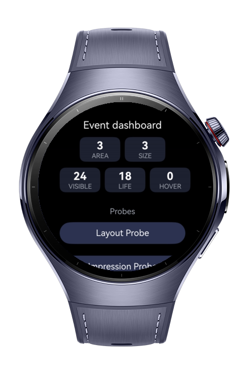
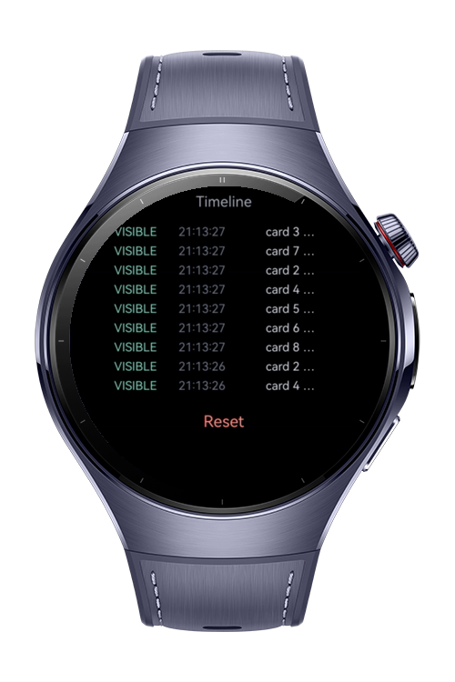
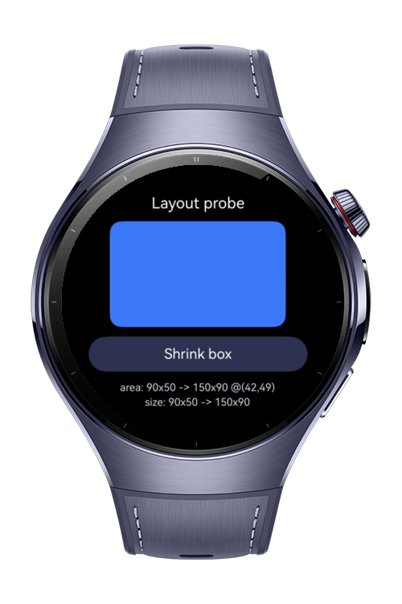
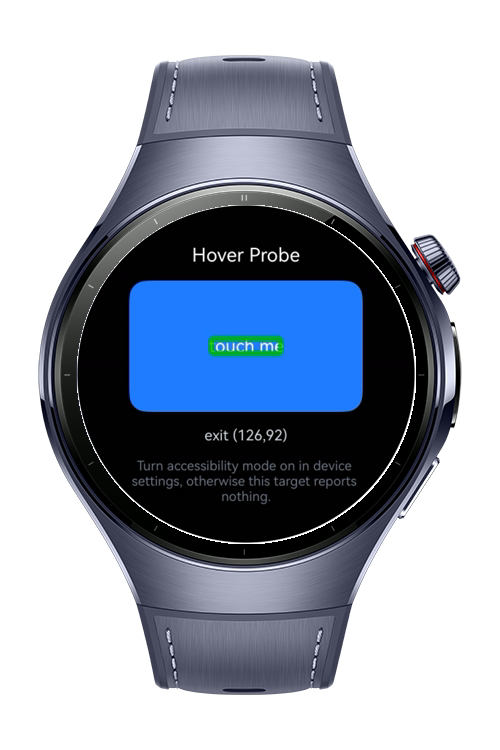

> **Note:** To access all shared projects, get information about environment setup, and view other guides, please visit [Explore-In-HMOS Index](https://github.com/Explore-In-HMOS/hmos-index).

# How to Build Component Event Tracker

How to Build Component Event Tracker is a HarmonyOS wearable codelab that demonstrates how to observe ArkUI component events on a watch and read what each one actually reports. It is aimed at developers who want to see an event's payload before wiring real logic to it. The app walks through five ArkUI component events in context, each attached to a working feature rather than a bare sample: a box that resizes itself, a scrolling card list, cards that mount and unmount, and an accessibility hover target. Every event that fires is counted and timestamped in a shared log, so the dashboard shows the counter and the payload the moment the event happens.

# Preview

<div>




</div>

# Use Cases

1. Layout Change Inspection: Resizing a box fires `onAreaChange` and `onSizeChange` together, so the difference between the two is visible side by side one carries size and position, the other only the size.

2. Impression Tracking: Scrolling the card list reports how much of each card is on screen through `onVisibleAreaApproximateChange`. A card counts as seen once it passes half visibility, which is the same rule an impression counter would use.

3. Lifecycle Logging: Tapping a card drops it out of the component tree and taps again bring it back, firing `onAppear` and `onDisAppear`. This keeps lifecycle separate from visibility: an item can be fully scrolled away while still mounted.

4. Accessibility Interaction Testing: With accessibility mode on, touching the hover target comes through as `onAccessibilityHover` with enter/exit and coordinates, so assistive-tech interaction can be checked on the device.

# Tech Stack

- **Languages**: ArkTS
- **Frameworks**: HarmonyOS SDK 6.0.1 (API 17 or later)
- **Tools**: DevEco Studio Vers 6.0.1 Release
- **Libraries**: @kit.ArkUI, @kit.AbilityKit, @kit.PerformanceAnalysisKit

# Directory Structure
   ```
   entry/src/main/ets/
 ├── pages
 │   ├── Index.ets                        // Navigation host and route map
 ├── views
 │   ├── DashboardPage.ets                // Counters per event type and the timeline log
 │   ├── LayoutProbePage.ets              // Area + Size demo (onAreaChange / onSizeChange)
 │   ├── ImpressionProbePage.ets          // Visible Area + Show/Hide demo (onVisibleAreaApproximateChange / onAppear / onDisAppear)
 │   ├── AccessibilityProbePage.ets       // Accessibility Hover demo (onAccessibilityHover)
 ├── viewmodel
 │   ├── DashboardViewModel.ets           // Counter and timeline reads, reset, probe navigation
 │   ├── LayoutProbeViewModel.ets         // Box sizing and deferred state writes for the layout callbacks
 │   ├── ImpressionProbeViewModel.ets     // Visibility threshold, seen set, card mount/unmount
 │   ├── AccessibilityProbeViewModel.ets  // Hover payload handling
 ├── services
 │   ├── EventLogService.ets              // Counter increments, capped log, hilog output
 │   ├── NavigationService.ets            // Singleton NavPathStack navigation
 ├── model
 │   ├── EventModels.ets                  // Event types, badge labels, log entry and card item
 │   ├── EventLogStore.ets                // Observable store shared by every screen
 ├── utils
 │   ├── Formatters.ets                   // Length to number, wall-clock time for the timeline
 │   ├── GlobalContext.ets                // UIAbility context holder used to terminate the app
   ```

# Constraints and Restrictions
- Accessibility mode has to be turned on in device settings before the hover probe reports anything. With it off the callback never runs and the counter stays at 0.
- Counters and the log live in memory only. They start empty on every launch.

## Supported Devices
- Huawei Watch 5

# License
**How to Build Component Event Tracker** is distributed under the terms of the MIT License
See the [LICENSE](./LICENSE) for more information.
